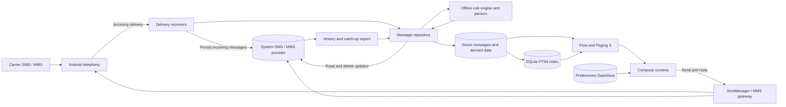

<!-- Modified for Inbo from Clear SMS. See LICENSE and NOTICE. -->

<p align="center">
  
</p>

<h1 align="center">inbo.</h1>

<p align="center"><strong>Your inbox, in order.</strong></p>

Inbo is a privacy-first default SMS app for Android. It sorts your inbox, surfaces verification codes, and turns transaction and bill messages into useful views. Classification, search, and parsing run on your phone.

Inbo is an independent fork of [Clear SMS](https://github.com/itsluminous/ClearSMS). It builds on Clear SMS’s Android messaging infrastructure, rules, sender database, and parsers.

## What you can do

| Area | Features |
| --- | --- |
| Inbox | All Messages, Personal, Transactions, OTPs, Updates, Promotions, Spam, and Unknown. Switch categories with chips or horizontal swipes. Choose **Always sort as** to remember a sender correction. |
| Messaging | Send and receive SMS, including multipart messages. Choose a SIM, keep drafts, reply from notifications, check delivery status, block senders, and manage messages in batches. |
| Search and saved messages | Search message text locally. Save receipts, addresses, and bookings, then reopen the original conversation from **Saved messages**. |
| Verification codes | Copy an OTP from its message or notification. Inbo shows an expiry when the text gives a recognizable validity window. Automatic copying is opt-in. |
| Finance and reminders | Review amounts extracted from SMS, see due reminders, and open **Daily briefing** for unread conversations and reminders due today. |
| Cleanup | Mark all inbox messages as read from the three-dot menu. Set separate retention policies for OTPs, promotions, and blocked senders. Scheduled cleanup defaults to **Never** and skips saved messages. |
| Notifications | Control ordinary messages, promotions, OTPs, reminders, and train updates received by SMS. Android manages notification channels and lock-screen presentation. |

Picture MMS depends on your carrier and device configuration. Group MMS appears under its sender. MMS delivery reports, RCS, live train tracking, and remote push are outside the app’s current scope.

## Build and install

| Requirement | Project setting |
| --- | --- |
| Java | JDK 17 |
| Android SDK | Platform 35, Build-Tools 36.0.0, and Platform-Tools for ADB |
| Device | Android 6.0 or later, with SMS support for carrier testing |
| Build | Checked-in Gradle wrapper |
| App ID | `app.inbo.sms` |

Clone the project, then build and install the debug APK.

```sh
git clone https://github.com/harishkotra/inbo.git
cd inbo
./gradlew assembleDebug
adb install -r app/build/outputs/apk/debug/Inbo-debug.apk
```

Set `ANDROID_HOME` or point `sdk.dir` in `local.properties` at your Android SDK. If you connected multiple devices, pass `-s SERIAL` to ADB. On Windows, use `gradlew.bat`.

Open Inbo and accept Android’s default SMS prompt. You can also check or request the role under **Settings → Messages → Default SMS app**. With the role granted, Inbo can receive new SMS and modify SMS-provider records. APK upgrades require the same signing key as the installed app. See the [build guide](docs/building.md) and [release signing guide](docs/release-signing.md).

## Architecture

Android’s telephony provider holds the shared message history. Inbo keeps a local Room projection of those messages for paging and search. Categories, extracted data, saved messages, and other app-specific state live in Inbo’s own storage. DataStore holds preferences such as enabled notifications and gesture settings.



| Technology | Role |
| --- | --- |
| Kotlin, Coroutines, and Flow | Asynchronous ingest, background operations, and observable screen state |
| Jetpack Compose and Material 3 | Native UI, light and dark themes, and settings |
| Room, SQLite FTS4, and Paging 3 | Local database, indexed message search, and paged lists |
| Android Telephony APIs and AndroidX Activity | Default SMS role, provider access, SIM selection, and messaging |
| WorkManager and AlarmManager | Checkpointed imports, periodic cleanup, and reminder alarms |
| Preferences DataStore | User settings and notification choices |
| Hilt and KSP | Dependency injection and code generation |
| kotlinx.serialization | Rules and local backup documents |
| JUnit, Robolectric, Truth, and ktlint | Regression tests, Android behavior tests, assertions, and formatting checks |

Dependency versions live in the [Gradle version catalog](gradle/libs.versions.toml). The [technical blog](docs/technical-blog.md) walks through delivery, deduplication, search, and cleanup.

### Where to start in the code

| Path | Purpose |
| --- | --- |
| [`app/src/main/kotlin/app/clearsms/sms/`](app/src/main/kotlin/app/clearsms/sms/) | Default role helper, telephony writes, SMS sender, and history import |
| [`app/src/main/kotlin/app/clearsms/data/`](app/src/main/kotlin/app/clearsms/data/) | Room, message repository, rule loading, preferences, and backups |
| [`app/src/main/kotlin/app/clearsms/domain/`](app/src/main/kotlin/app/clearsms/domain/) | Classification, parsers, and models |
| [`app/src/main/kotlin/app/clearsms/ui/`](app/src/main/kotlin/app/clearsms/ui/) | Inbox, conversations, Finance, Alerts, and Settings |
| [`rules/`](rules/) and [bundled rules](app/src/main/assets/default_rules.json) | Rule source files and the merged asset loaded by the app |
| [`app/schemas/`](app/schemas/) and [`app/src/test/`](app/src/test/) | Committed Room migration schemas and test fixtures |

### Example rule

Consider a fictional sender `EXMPLD` sending “Parcel ZX81 is out for delivery.” A narrow rule can label it as an update and extract its tracking reference.

```json
{
  "id": "example-delivery-status",
  "name": "Example courier delivery status",
  "priority": 120,
  "match": {
    "sender_pattern": "(?i)^EXMPLD$",
    "body_pattern": "(?i)\\bparcel ([A-Z0-9]{4,16}) is out for delivery\\b"
  },
  "action": {
    "category": "important",
    "sub_category": "delivery",
    "extract": {
      "tracking_id": "$1"
    }
  }
}
```

The UI calls the `important` category **Updates**. The rule engine checks user rules before bundled rules, then uses sender lookup, content signals, and contacts before falling back to Unknown. Final checks protect verification codes and completed transactions from unsuitable categories.

## Privacy and local data

- Inbo requests no Android Internet permission and has no server, account requirement, or analytics.
- Message bodies and derived data are stored locally. The Android manifest disables app auto-backup. Some Android device manufacturers handle direct device transfers separately. [Android backup documentation](https://developer.android.com/identity/data/autobackup)
- Manual exports and optional scheduled local backups use storage you choose. Exported files can contain message bodies, so handle them as private data.
- OTP expiry is inferred from messages that state one supported duration. When the message is ambiguous, Inbo leaves the expiry unspecified.

## Fork and contribute

1. Use **Fork** on [Inbo’s GitHub repository](https://github.com/harishkotra/inbo), then clone your fork. [GitHub’s fork guide](https://docs.github.com/en/pull-requests/how-tos/work-with-forks/fork-a-repo)
2. Add Inbo as the upstream remote and start a branch. Replace `YOUR_GITHUB_NAME` with your username.

   ```sh
   git clone https://github.com/YOUR_GITHUB_NAME/inbo.git
   cd inbo
   git remote add upstream https://github.com/harishkotra/inbo.git
   git fetch upstream
   git switch -c improve-delivery-rules upstream/main
   ```

3. Run the checks for your change, push the branch to your fork, and open a pull request against Inbo’s `main`. Describe the behavior change and what you tested.

   ```sh
   ./gradlew ktlintCheck lintDebug testDebugUnitTest
   git push -u origin improve-delivery-rules
   ```

For rules and parsers, pair a positive synthetic message with a near-miss that should keep its existing classification. Keep source rules and bundled assets in sync. For Room changes, commit the exported schema and exercise migrations from an existing install. Preserve the license, notices, and change attribution when distributing a fork. See [CONTRIBUTING.md](CONTRIBUTING.md), the [rule walkthrough](docs/adding-rules.md), and the [translation guide](docs/translating.md).

### Finding missing rules using your own messages

Start with the checked-in synthetic corpus.

```sh
python3 scripts/audit_rule_coverage.py scripts/demo/messages.jsonl
```

For a local audit on your phone, enable USB or wireless debugging, connect with ADB, and run the same script with `--from-device`. Android or the phone manufacturer may restrict shell access to the SMS provider. Keep raw device exports out of Git and review audit output for names, phone numbers, account details, links, and codes before sharing any examples. The [emulator guide](scripts/demo/README.md) describes a synthetic test workflow.

### Ideas for contributions

- **Saved-message collections.** Add optional labels for receipts, travel, and reference messages while keeping the single Saved messages entry.
- **Better local search filters.** Add sender and date facets on top of the existing FTS query and paging path.
- **More regional rules.** Cover additional bank, transit, utility, and government formats with synthetic positive and negative fixtures.
- **Accessibility coverage.** Test large fonts and TalkBack in dense inbox rows, the selection toolbar, and notification settings.

## Origin, license, and artwork

Inbo derives from [Clear SMS at commit `dbfaf7256a5d5e03ab1af3035efb5521273a577a`](https://github.com/itsluminous/ClearSMS/commit/dbfaf7256a5d5e03ab1af3035efb5521273a577a). Original copyright belongs to the Clear SMS contributors. Inbo adds its own branding, Pip, inbox organization, OTP expiry, saved messages, Daily briefing, selection controls, and organizer settings.

The source code uses the [Apache License 2.0](LICENSE). The original [NOTICE](NOTICE) and license ship in the APK under `assets/licenses/`. **Settings → About → Open source licenses** credits Clear SMS contributors. Modified upstream files carry change notices.

Bundled sender logos identify message senders. Their sources, MIT notices, and trademark attribution appear in the [logo provenance manifest](app/src/main/assets/logos/MANIFEST.md) and [NOTICE](NOTICE). Pip comes from the Inbo Pip asset kit. Artwork and trademark permissions are separate from the source code license.

## Translations

<!-- translation-status:start -->
<!-- Generated by scripts/translation_status.py - do not edit by hand. -->
| Language | Code | Translated | Coverage |
| --- | --- | ---: | ---: |
| Hinglish | `b+hi+Latn` | 821 / 872 | 94% |
| German | `de` | 821 / 872 | 94% |
| Spanish | `es` | 821 / 872 | 94% |
| Hindi | `hi` | 821 / 872 | 94% |
| Polish | `pl` | 821 / 872 | 94% |
| Russian | `ru` | 821 / 872 | 94% |

Coverage counts strings the translation defines, out of 872 translatable items in English (each plural counted once); it measures presence, not quality. Regenerate with `python3 scripts/translation_status.py`.
<!-- translation-status:end -->

---

Built by [Harish Kotra](https://harishkotra.me). [Check out my other builds](https://dailybuild.xyz).
